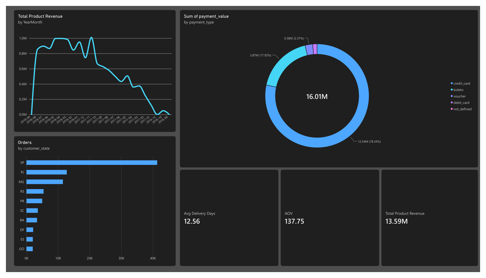

# Olist E-Commerce Executive Dashboard (Power BI)

An interactive Power BI executive dashboard built on the **Olist Brazilian E-Commerce** dataset (~100k orders), using a **star-schema data model** and **DAX measures** for sales, payments, and delivery KPIs.

This project extends my [Olist SQL Analysis](https://github.com/bagherikiana/olist_sql_analysis): the data validated in SQLite is exported into a star schema with Python and turned into decision-ready reporting.



---

## Business Questions

1. How are sales trending over time?
2. What is the average order value and total product revenue?
3. How do customers pay?
4. Which states drive the most orders?
5. How long does delivery take on average?

---

## Dashboard: Executive Overview

| Visual | Purpose |
| ------ | ------- |
| KPI card: **Total Product Revenue** | Overall product sales |
| KPI card: **AOV** (Average Order Value) | Revenue per order |
| KPI card: **Avg Delivery Days** | Baseline delivery performance |
| Line chart: **Monthly Product Revenue** | Sales trend over time |
| Donut chart: **Payment Value by Payment Type** | Payment method mix |
| Bar chart: **Orders by Customer State** | Geographic demand |

### Headline KPIs

| KPI | Value |
| --- | ----: |
| Total Product Revenue | 13.59M |
| Average Order Value | 137.75 |
| Average Delivery Time | 12.56 days |

---

## Data Model (Star Schema)

```text
                 DimDate
                    │
DimCustomer ── FactSales ── DimProduct
                    │  └─── DimSeller
                 DimOrder

FactPayments ── DimDate / DimOrder / DimCustomer
FactReviews  ── DimDate / DimOrder / DimCustomer
```

| Table | Type | Grain | Rows |
| ----- | ---- | ----- | ---: |
| FactSales | Fact | One row per order item | 112,650 |
| FactPayments | Fact | One row per payment | 103,886 |
| FactReviews | Fact | One row per review | 99,224 |
| DimCustomer | Dimension | One row per customer | 99,441 |
| DimOrder | Dimension | One row per order | 99,441 |
| DimProduct | Dimension | One row per product | 32,951 |
| DimSeller | Dimension | One row per seller | 3,095 |
| DimDate | Dimension | One row per day | 774 |

Row counts above match the exported star-schema CSVs (`data/model/`). Dashboard KPI cards (13.59M revenue, AOV 137.75, 12.56 delivery days) come from the Power BI model measures.

All relationships are **many-to-one** with **single-direction** filtering from dimensions to facts.

---

## DAX Measures

Measures are organized into display folders. Full code: [`dax/measures.dax`](dax/measures.dax).

**Sales**
```DAX
Total Product Revenue = SUM ( FactSales[product_revenue] )
Total Freight         = SUM ( FactSales[freight_value] )
Total Gross Revenue   = SUM ( FactSales[gross_revenue] )
Orders                = DISTINCTCOUNT ( FactSales[order_id] )
Items Sold            = COUNTROWS ( FactSales )
AOV                   = DIVIDE ( [Total Product Revenue], [Orders] )
Customers             = DISTINCTCOUNT ( FactSales[customer_id] )
Revenue per Customer  = DIVIDE ( [Total Product Revenue], [Customers] )
```

**Payments**
```DAX
Payment Transactions = COUNTROWS ( FactPayments )
Total Payment Value  = SUM ( FactPayments[payment_value] )
```

**Delivery & Satisfaction**
```DAX
Avg Review Score  = AVERAGE ( FactReviews[review_score] )
Avg Delivery Days = AVERAGE ( DimOrder[delivery_days] )
On-Time Delivery % =
    DIVIDE (
        CALCULATE ( COUNTROWS ( DimOrder ), DimOrder[delivered_on_time_flag] = 1 ),
        CALCULATE ( COUNTROWS ( DimOrder ), NOT ISBLANK ( DimOrder[delivered_on_time_flag] ) )
    )
```

**Time Intelligence**
```DAX
Revenue YTD            = TOTALYTD ( [Total Product Revenue], DimDate[Date] )
Revenue Previous Month = CALCULATE ( [Total Product Revenue], DATEADD ( DimDate[Date], -1, MONTH ) )
Revenue MoM %          = DIVIDE ( [Total Product Revenue] - [Revenue Previous Month], [Revenue Previous Month] )
```

---

## Key Insights

From this dashboard and the underlying [SQL analysis](https://github.com/bagherikiana/olist_sql_analysis):

- Revenue grew substantially from 2017 into 2018, with **November 2017** as the strongest month.
- **Credit card** is the dominant payment method (~74% of payment records).
- Demand is concentrated in **São Paulo (SP)**, followed by Rio de Janeiro and Minas Gerais.
- Average delivery takes **12.56 days**, and longer deliveries are associated with lower review scores (**4.42** under 7 days vs **3.12** over 21 days).

---

## Project Structure

```text
olist_sql_analysis  (branch: powerbi)
├── Olist_Ecommerce_Dashboard.pbix   # Power BI report
├── images/
│   └── executive_dashboard.png      # Dashboard screenshot
├── dax/
│   └── measures.dax                 # All DAX measures
├── scripts/
│   └── export_star_schema.py        # SQLite → star-schema CSVs (Python, Pandas)
└── README.md
```

This Power BI project lives on the `powerbi` branch of the same Olist repo (files at branch root).  
The star-schema CSVs (`data/model/`) are not committed because of their size. Regenerate from `olist.db`:

```bash
python scripts/export_star_schema.py
```

---

## Tools

Power BI Desktop · DAX · Power Query · Python (Pandas) · SQLite · Git

---

## Author

**Kiana Bagheri**: Junior Data Analyst with a Mechanical Engineering background.
[LinkedIn](https://www.linkedin.com/in/bagherikiana) · [GitHub](https://github.com/bagherikiana)
